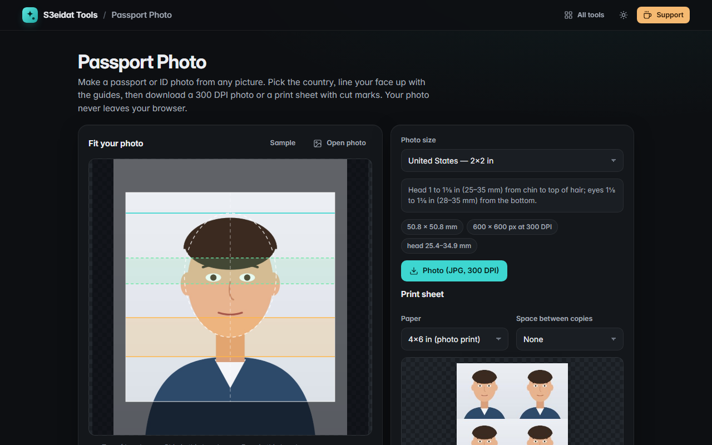

# Passport Photo

> Passport and ID photos, print-ready. Free, private, and it runs entirely in your browser.

### ▶ [Open Passport Photo](https://s3eidat.github.io/passport-photo/)



## Features

- Sizes: **US 2×2 in**, **UK 35×45 mm**, **EU / Schengen 35×45 mm**, **Jordan 4×6 cm**, **Saudi Arabia 4×6 cm**,
  **Canada 50×70 mm**, **India 2×2 in**, **China 33×48 mm**, or a **custom** size and head range
- **Guides** drawn over the photo: top-of-head line, chin band (from the published head-size range), eye band where the
  rule gives one (US), head outline and centre line
- **Drag to move, scroll or pinch to zoom**, straighten (±20°), rotate 90°, arrow keys to nudge
- **Brightness and contrast**
- Export the photo as a **300 DPI JPG** (the DPI is written into the file so it prints at the true size)
- **Print sheet** on 4×6 in, 10×15 cm, A4 or US Letter: as many copies as fit (both orientations are tried),
  optional spacing, **cut marks**; download it or print it directly
- Settings are remembered

Jordan and Saudi 4×6 cm: no official head-size figure is published, so the guide shows a typical framing (the page
says so). Rules change, so **check your country's current official requirements** before you submit. This tool does
not remove or replace backgrounds.

## Privacy

Your photo never leaves your device. There is no server, no account, no analytics.
The page ships with a strict Content-Security-Policy (`connect-src 'self'`), so the browser
itself blocks any attempt to send data anywhere.

## Run it yourself

It's plain HTML, CSS and JavaScript with no build step:

```bash
git clone https://github.com/s3eidat/passport-photo
cd passport-photo
python -m http.server 8000
```

Then open http://localhost:8000.

## Support

If this saved you time, **[buy me a coffee ☕](https://s3eidat.github.io/coffee/)**. It keeps every tool free.

---

Part of **[S3eidat Tools](https://s3eidat.github.io/)**: 100+ free, private tools that run in your browser. MIT licensed.
